# Personal Expense Manager

**v1.0.0 - Offline-only.** An Android portfolio app for tracking income, expenses, wallets, custom categories and monthly budgets. The app opens directly into Home with one local financial profile.

## Screenshots

Captured on Pixel 5 / API 35. Financial screens use sample data. Settings captures are refreshed for the offline release; earlier financial captures retain the same features.

| Home | Transactions |  |  |
| :---: | :---: | :---: | :---: |
| 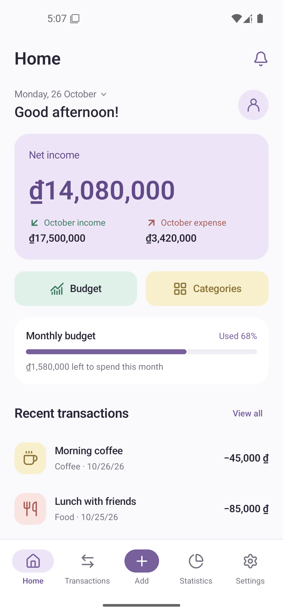 | 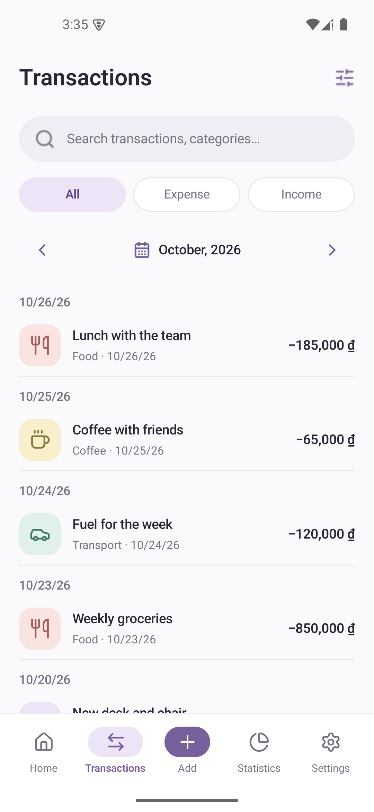 |  |  |

| Add transaction | Transaction details | Statistics | Transaction filters |
| :---: | :---: | :---: | :---: |
| 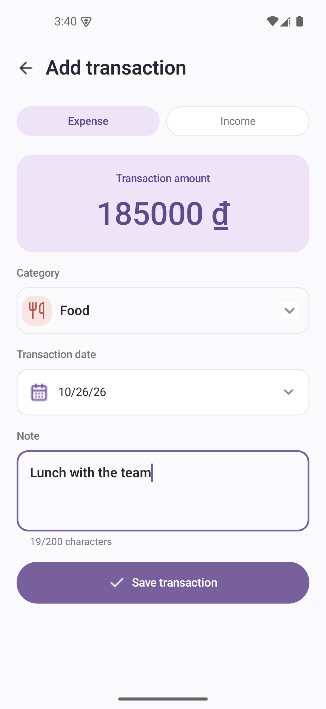 | 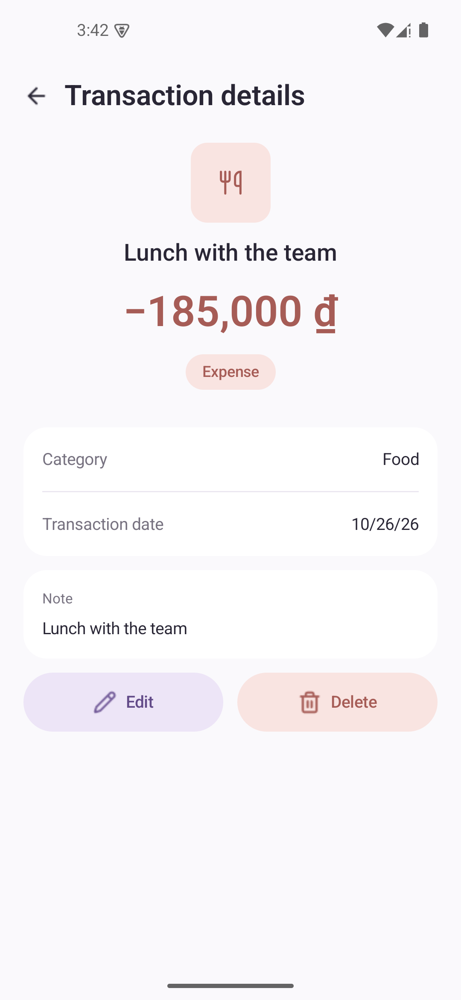 | 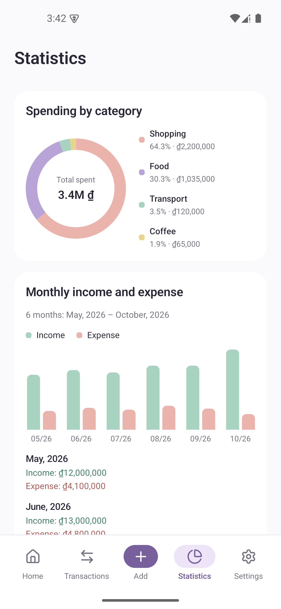 | 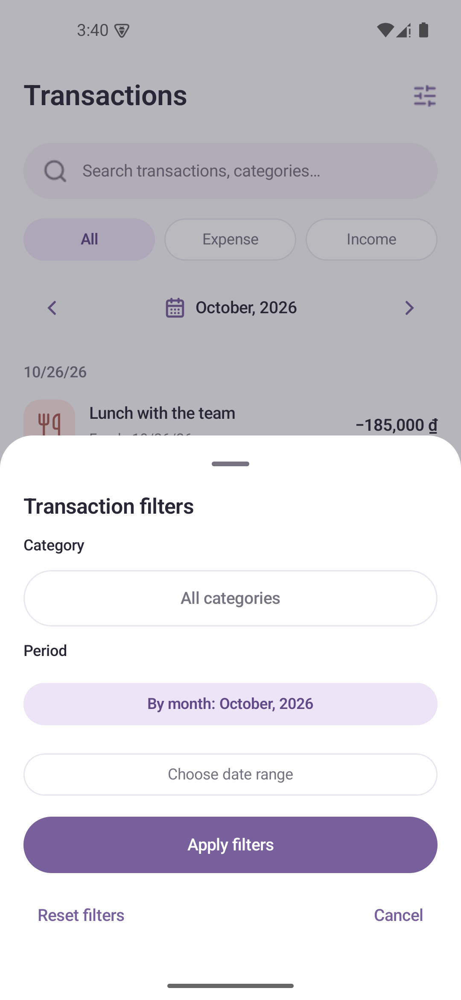 |

| Monthly budget | Categories | No budget or expenses | Over budget |
| :---: | :---: | :---: | :---: |
| 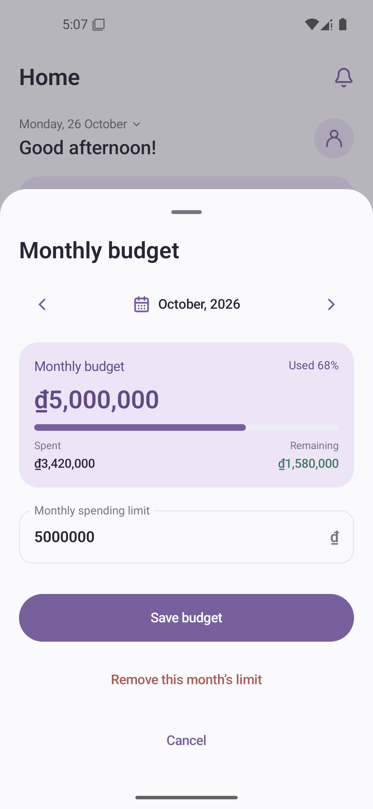 | 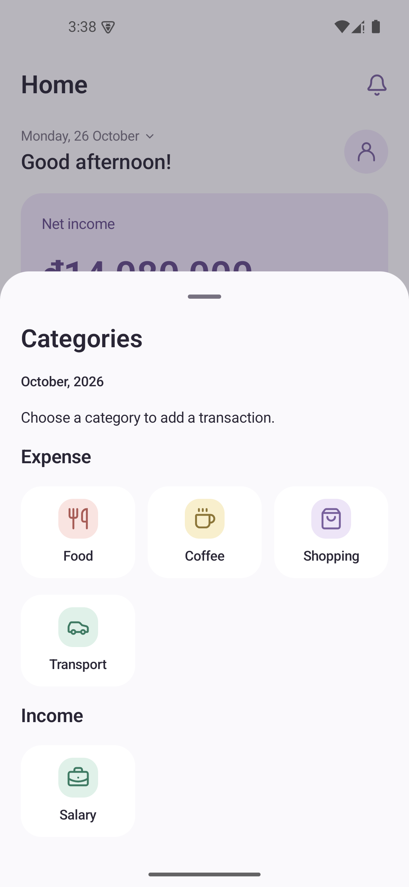 | 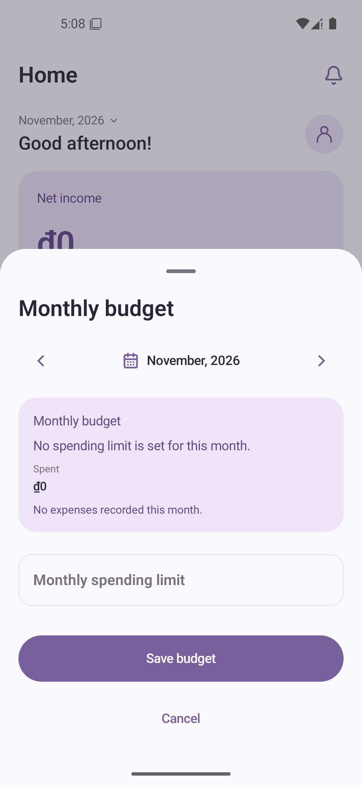 | 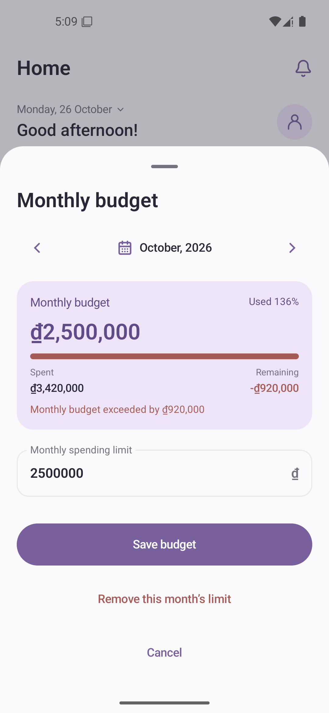 |

| Category management | Category budgets | CSV export |  |
| :---: | :---: | :---: | :---: |
| 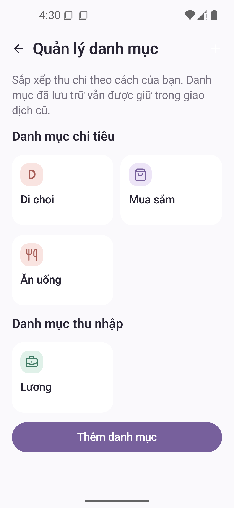 | 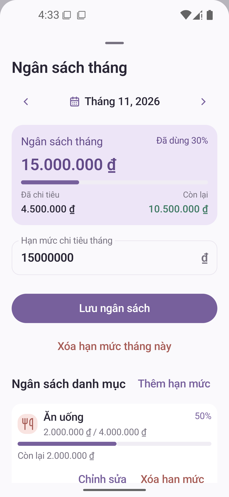 | 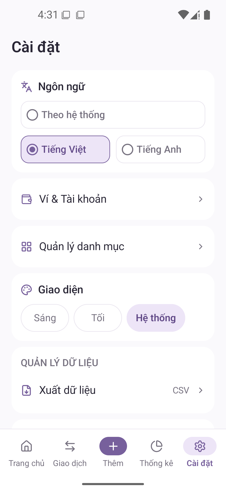 |  |

| Wallets | Wallet details | Edit wallet | Transaction wallet selection |
| :---: | :---: | :---: | :---: |
| 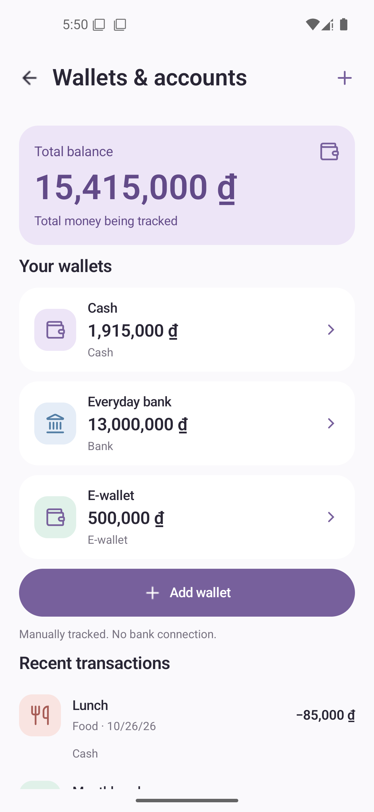 | 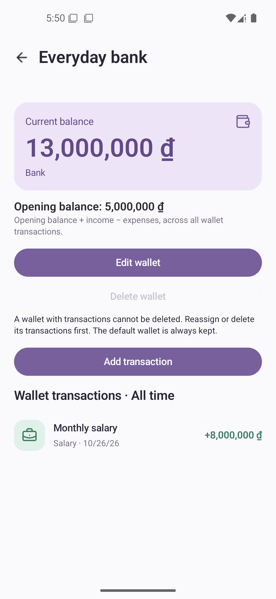 | 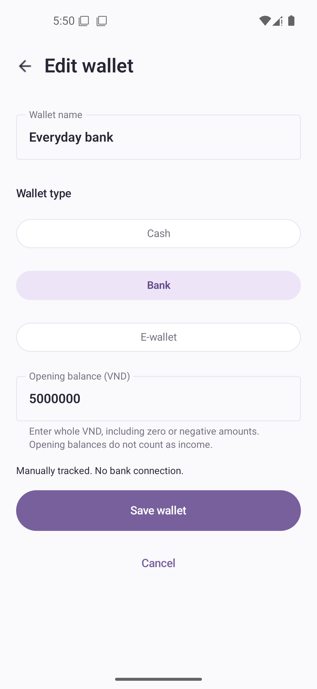 | 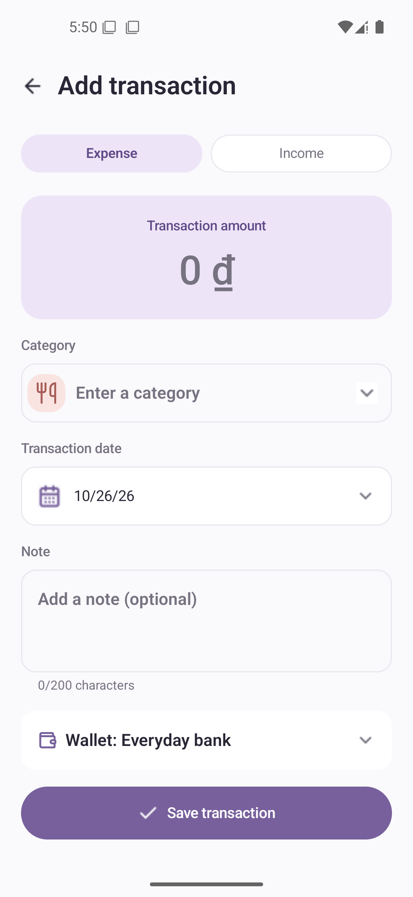 |

| Vietnamese / Light | English / Dark |  |  |
| :---: | :---: | :---: | :---: |
| 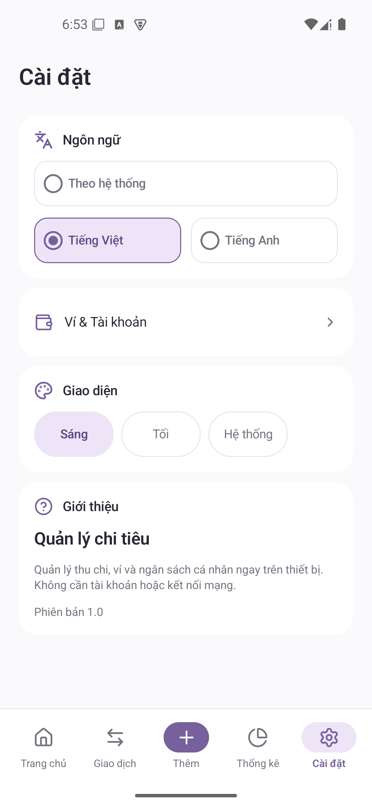 | 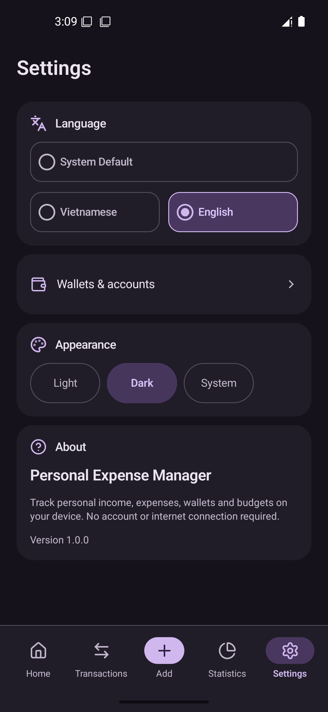 |  |  |

## Features

- Add, edit and delete income/expenses with category, date, note and wallet.
- Manage manual cash, bank and e-wallet balances in VND.
- View monthly totals, overall and per-expense-category budgets, and spending warnings.
- Search and filter transactions by type, category and date.
- Manage custom income and expense categories locally, including rename, archive, restore and guarded delete.
- View category charts and six-month income/expense comparisons.
- Choose Vietnamese/English and Light/Dark/System appearance.
- Export every saved transaction to a user-selected CSV file without network or broad storage access.
- Open and use every financial feature without an account or network.

Financial data remains in the existing local Room database, monthly budget preferences and category budgets. Updating the app preserves that data; uninstalling or clearing Android app storage can remove it. This release has no login, per-account data ownership, in-app cloud backup or synchronization.

Android backup and device-transfer exports are disabled. Keep the installed app and its local storage when updating.

## Future Improvements

- Cloud Backup & Restore, with explicit ownership, validation and confirmed restoration.
- Local Multi-account, with separate financial data per profile and a deliberate plan for existing ownerless data.

## Tech stack

Kotlin · Jetpack Compose · Material 3 · Room · Hilt · Coroutines/StateFlow · Navigation Compose.

MVVM + Clean Architecture in one `:app` module: `presentation → domain ← data`. See [Architecture](docs/ARCHITECTURE.md).

## Getting started

Requires Android Studio supporting **AGP 9.4.1**, **JDK 25**, **SDK 37**, Build Tools **36.0.0**, and an **API 26+** device. Gradle is provided by the wrapper.

1. Clone the repository and open it in Android Studio.
2. Set your Android SDK path in `local.properties`.
3. Sync Gradle, select `app`, and click **Run**. No service configuration or credentials are required.

## Build & test

```powershell
.\gradlew.bat :app:assembleDebug :app:assembleRelease :app:testDebugUnitTest :app:lintDebug
```

For the offline launch regression on a connected emulator, install updates without clearing storage:

```powershell
.\gradlew.bat :app:assembleDebugAndroidTest
adb install -r app/build/outputs/apk/debug/app-debug.apk
adb install -r app/build/outputs/apk/androidTest/debug/app-debug-androidTest.apk
adb shell am instrument -w -e class com.ngyennhi.expensemanager.presentation.OfflineFlowTest com.ngyennhi.expensemanager.test/com.ngyennhi.expensemanager.HiltTestRunner
```

The regression uses isolated test storage. For an existing installation, keep the application ID and signing key, use `adb install -r`, and do not uninstall or clear app storage. Room uses schema v4 with database `expense_manager.db`; whole-month budgets keep `monthly_budgets`, while category budgets use the Room database. [TASK-013](tasks/TASK-013.md) records release checks and the manual emulator checklist.

On macOS/Linux, use `sh ./gradlew`. Debug APK: `app/build/outputs/apk/debug/app-debug.apk`.

## Documentation

[Project](docs/PROJECT.md) · [Design](docs/DESIGN.md) · [Roadmap](tasks/ROADMAP.md) · [Contributing](AGENTS.md) · [CI](.github/workflows/android-ci.yml)
