# Personal Expense Manager

An Android portfolio app for tracking income, expenses, wallets and monthly budgets. Core features work offline without an account.

## Screenshots

Captured on Pixel 5 / API 35. Financial screens use sample data. The Login screenshot shows the Google button; the Register and Settings screenshots predate the TASK-012 account updates.

| Log in | Register | Home | Transactions |
| :---: | :---: | :---: | :---: |
| 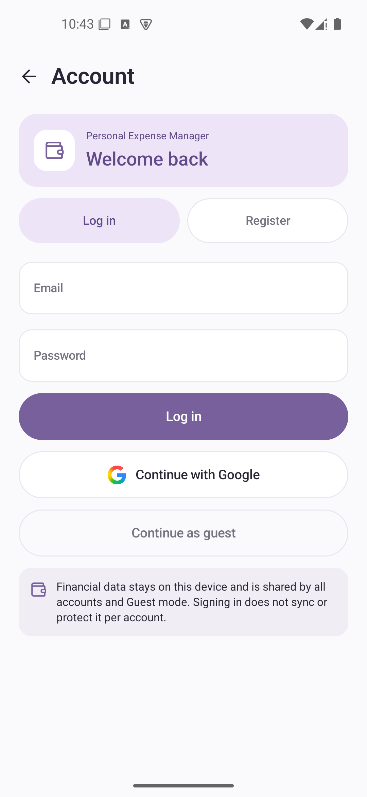 | 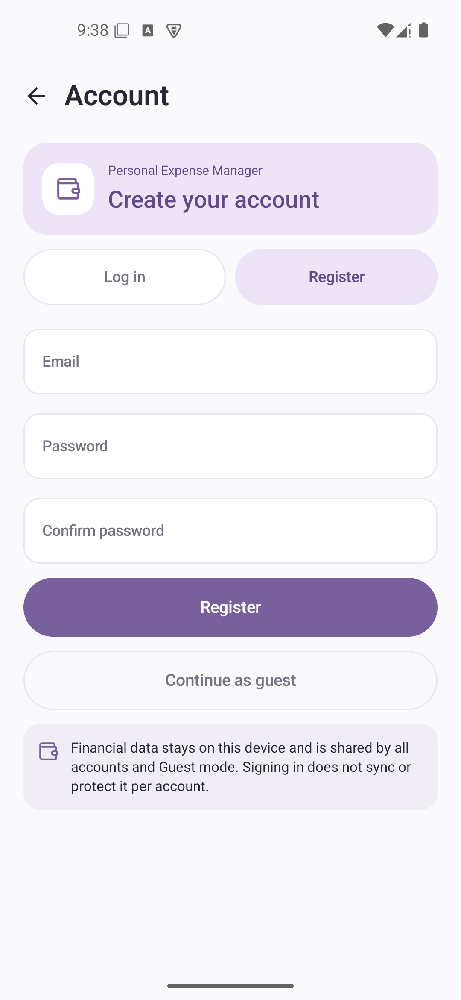 | 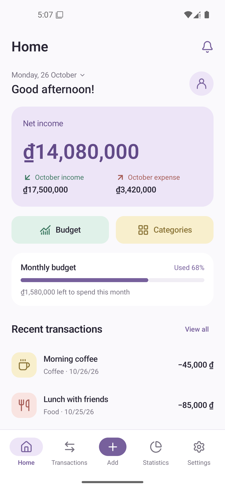 | 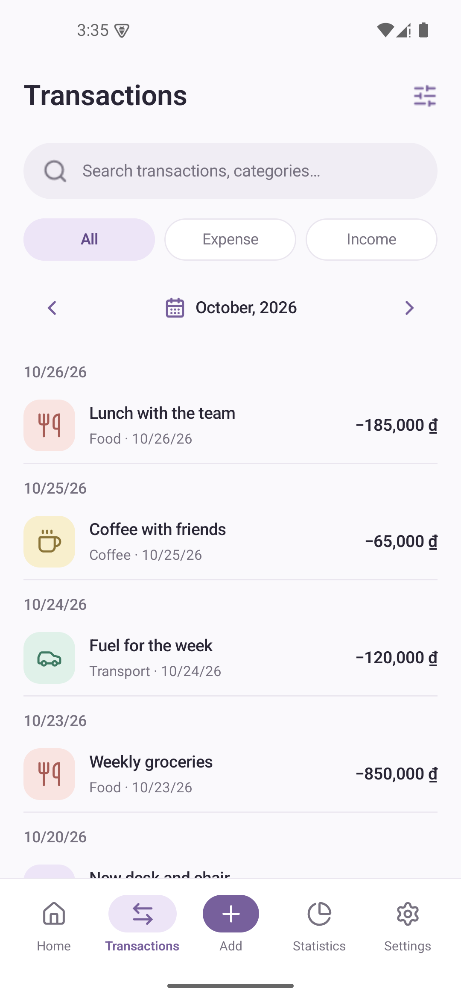 |

| Add transaction | Transaction details | Statistics | Transaction filters |
| :---: | :---: | :---: | :---: |
| 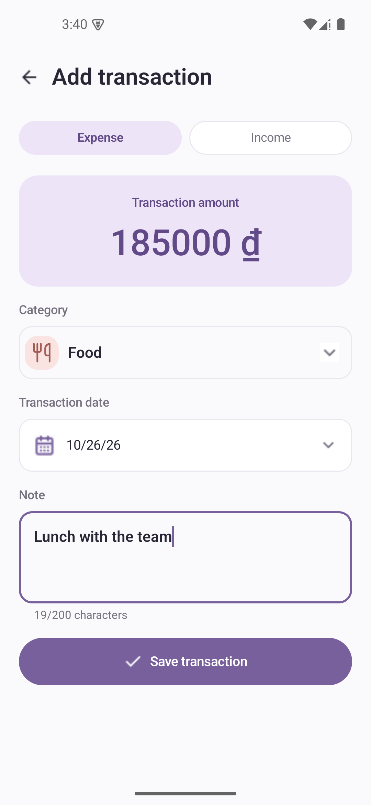 | 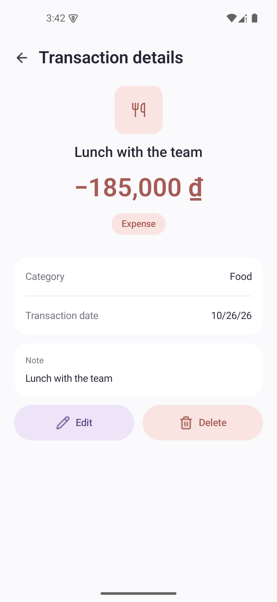 | 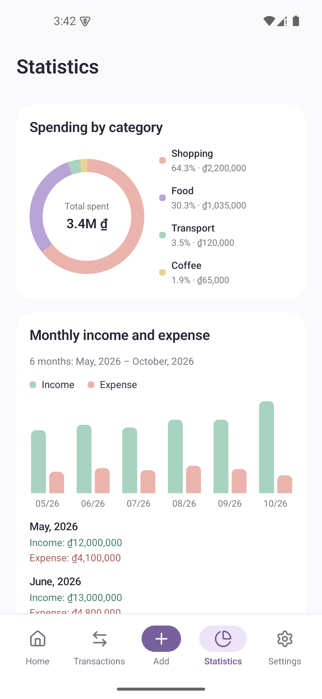 | 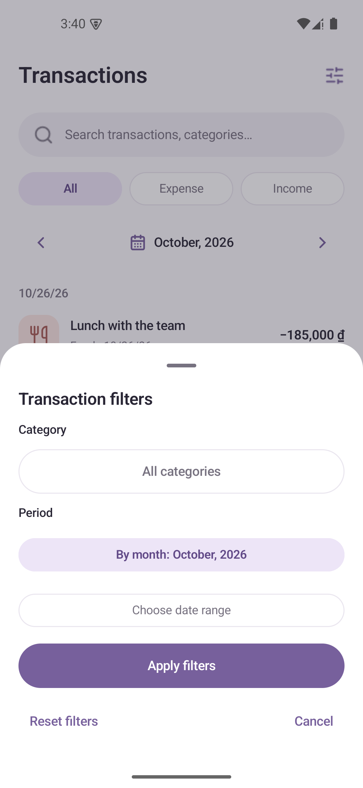 |

| Monthly budget | Categories | No budget or expenses | Over budget |
| :---: | :---: | :---: | :---: |
| 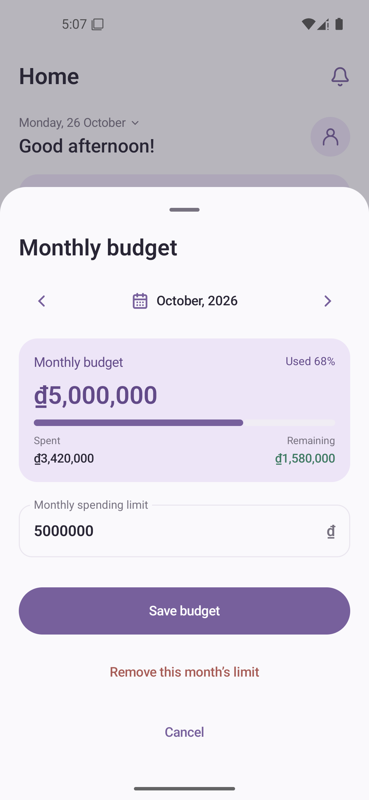 | 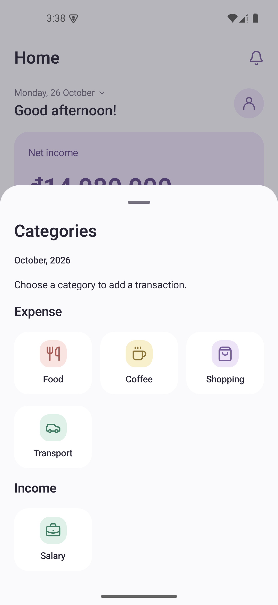 | 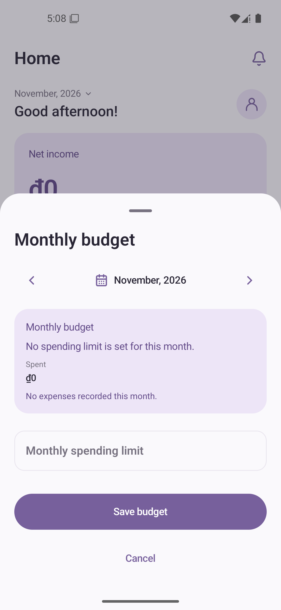 | 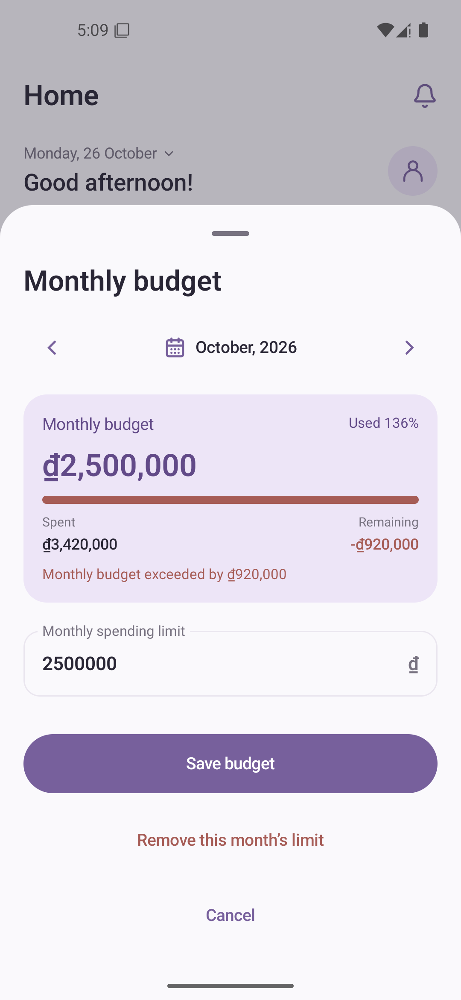 |

| Wallets | Wallet details | Edit wallet | Transaction wallet selection |
| :---: | :---: | :---: | :---: |
| 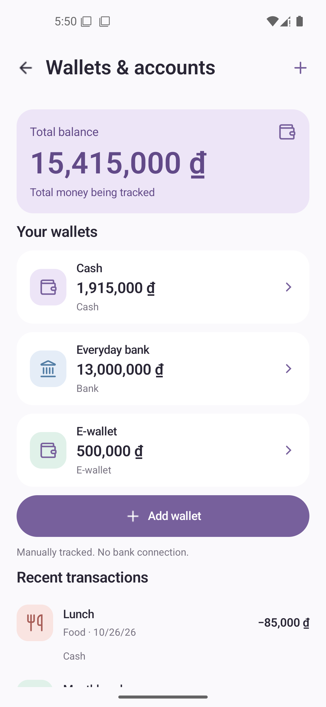 | 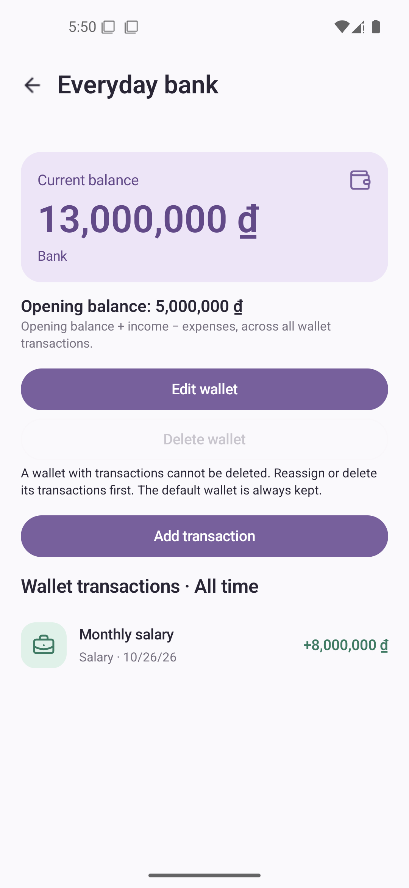 | 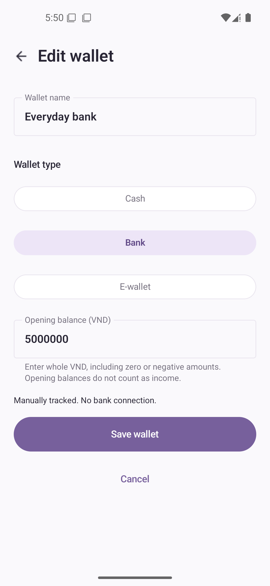 | 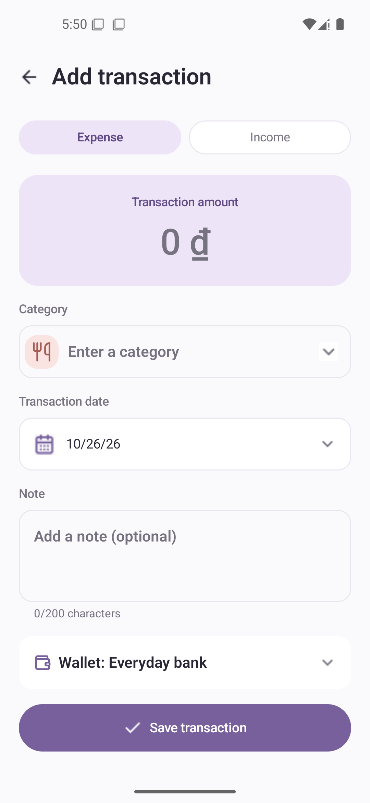 |

| Vietnamese / Light | English / Dark |  |  |
| :---: | :---: | :---: | :---: |
| 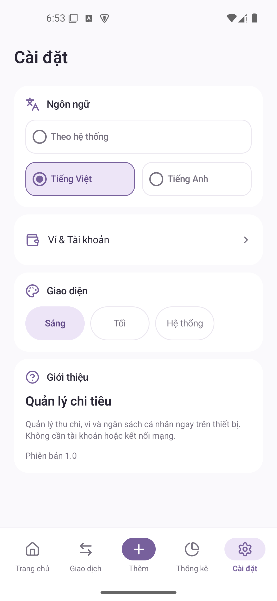 | 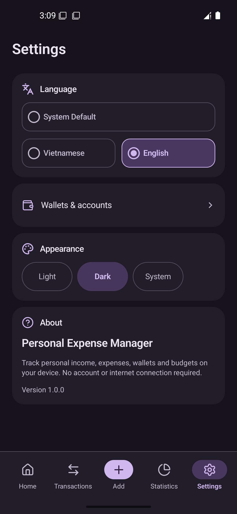 |  |  |

## Features

- Add, edit and delete income/expenses with category, date, note and wallet.
- Manage manual cash, bank and e-wallet balances in VND.
- View monthly totals, budgets and spending warnings.
- Search and filter transactions by type, category and date.
- View category charts and six-month income/expense comparisons.
- Choose Vietnamese/English and Light/Dark/System appearance.
- Use Guest mode or optional Firebase Email/Password login, registration, Google sign-in and logout.

**Data stays on the device and is shared by Guest mode and all accounts. It is not protected separately per account.** Login/logout never merges, deletes or syncs financial data. Cloud sync and bank connections are not implemented.

## Tech stack

Kotlin · Jetpack Compose · Material 3 · Room · Firebase Authentication · Hilt · Coroutines/StateFlow · Navigation Compose.

MVVM + Clean Architecture in one `:app` module: `presentation → domain ← data`. See [Architecture](docs/ARCHITECTURE.md).

## Getting started

Requires Android Studio supporting **AGP 9.4.1**, **JDK 25**, **SDK 37**, Build Tools **36.0.0**, and an **API 26+** device. Gradle is provided by the wrapper.

1. Clone the repository and open it in Android Studio.
2. Configure Firebase below and set your Android SDK path.
3. Sync Gradle, select `app`, and click **Run**.

After verifying the console policy, opt in for the build from PowerShell:

```powershell
$env:ORG_GRADLE_PROJECT_googleSeparateAccountsConfirmed = 'true'
.\gradlew.bat :app:assembleDebug
```

This flag only confirms the project setting; it cannot configure Firebase remotely. Without the flag, the Google button reports that sign-in is not configured and cannot send a Google credential to Firebase. No automatic provider linking or account migration is implemented. Google sign-out also clears Credential Manager's active credential state; local Guest access remains available if provider cleanup fails.

For Guest-only builds, if no local config exists:

```powershell
Copy-Item app/google-services.example.json app/google-services.json
```

The example uses dummy credentials; live authentication requires a real Firebase config. CI uses the example unless the optional **`FIREBASE_GOOGLE_SERVICES_JSON`** repository secret supplies the full JSON.

## Build & test

```powershell
.\gradlew.bat :app:assembleDebug :app:testDebugUnitTest :app:lintDebug
```

Device tests, with an emulator/device connected:

```powershell
.\gradlew.bat :app:connectedDebugAndroidTest
```

On macOS/Linux, use `./gradlew`. APK: `app/build/outputs/apk/debug/app-debug.apk`.

## Documentation

[Project](docs/PROJECT.md) · [Design](docs/DESIGN.md) · [Roadmap](tasks/ROADMAP.md) · [Contributing](AGENTS.md) · [CI](.github/workflows/android-ci.yml)
